# Abilmente Milano - tutti i mondi creativi al Superstudio Maxi

>**Laboratori, arte manuale e solidarietà**: Abilmente è l'evento di IEG leader per la creatività

_di Maria Rosa Sirotti_
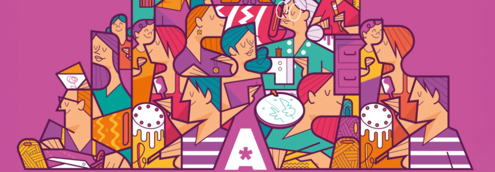

Con oltre **120 brand espositori** e un ricco programma esperienziale, **Abilmente Milano** ha offerto ai partecipanti tanti workshop pratici per imparare tante **tecniche creative** e dare vita a **progetti fai-da-te**.
Punto di riferimento per la community del DIY, è stata una quattro giorni immersiva rivolta a neofiti, esperti e appassionati di tutte le età. 

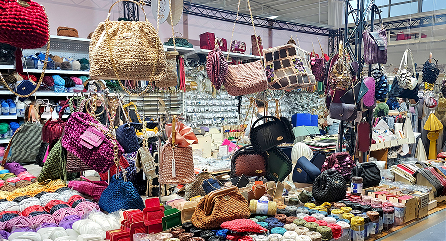

Il cuore della manifestazione è stata la **Via delle Idee**, l'area espositiva che riunisce le **creazioni dei diversi
mondi del DIY**: dai bijoux agli accessori, passando per la carta, lo scrapbooking, il colore, il ricamo tradizionale, il cucito e i filati. 

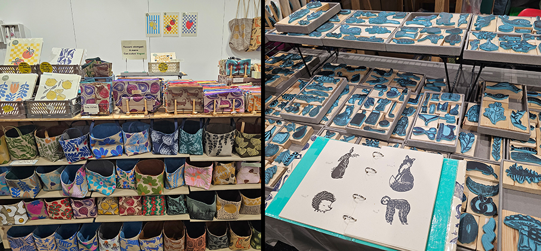

**KIAMON DESIGN** – _Blockprinting_ Realizza prodotti artigianali partendo dalla creazione del disegno, che viene riversato su linoleum e inciso a mano. Una volta ottenuto il negativo, crea le texture su tessuto, lo modella e lo cuce per ottenere bellissimi prodotti.

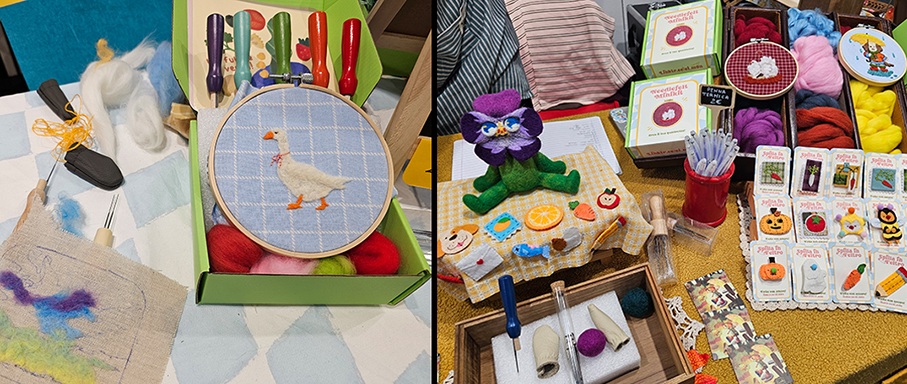

**NENEEDLE** - _Punch Needle_ Un fiber artist che realizza lavori, insegna tecniche e crea kit e materiali per imparare ricamo moderno, punch needle, rammendo visibile e non solo.

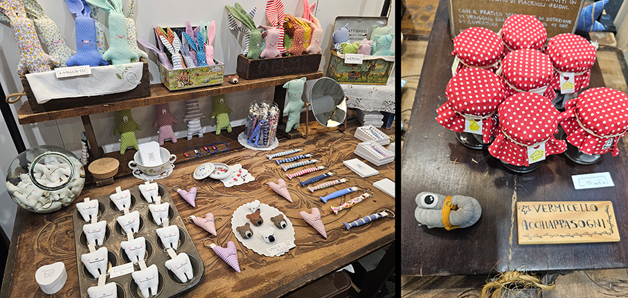

**PIUTÌ by EVITA** - _Cucito Creativo_ Realizza pupazzi che paiono sempre uscire da una storia e in una storia collocarsi.

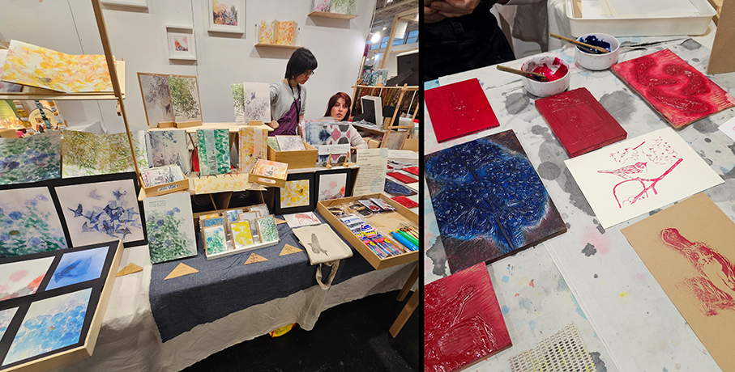

**GALLERIA NOBILI PARAVENTI GIAPPONESI** - _Stampa Giapponese_ Raffaella la gallerista, Asako l'artista e Kiyofumi il designer, insieme hanno creato una linea grafica di manufatti realizzati con la tecnica della stampa giapponese mokuhanga, sia su carta che su tessuto.

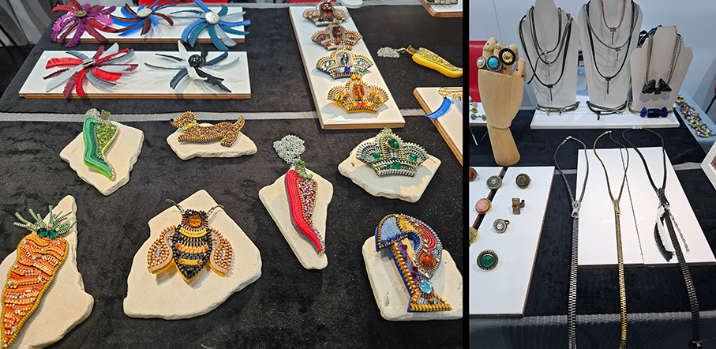

**LE CERNIERINE** - _Progetto di Upcycling Bijoux_ , creazione di bijoux realizzati a mano utilizzando solo cerniere di recupero: bracciali, anelli, collane e spille uniche che alimentano l'economia circolare.

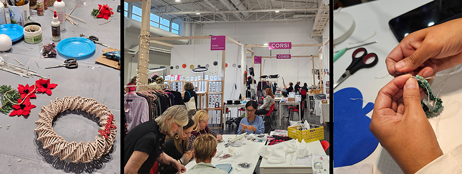

Punto di riferimento per chi desiderava **imparare nuove tecniche** o perfezionare le proprie abilità, **Abilmente Academy** ha offerto un ricco programma di workshop nel corso delle quattro giornate milanesi. 
I partecipanti si sono cimentati in discipline variegate come la pirografia su legno, il tufting, l'uncinetto tunisino e mosaico, la creazione di fiori di carta e di zucche decorative in stoffa. 

Spazio anche alla **stampa botanica** con la cianotipia, all'autoproduzione **cosmetica** di shampoo vegetale e creme viso, fino alla realizzazione di **candele**, alla **sartoria** pratica per confezionare shopper e alle tecniche di **pittura ad acquerello**. 

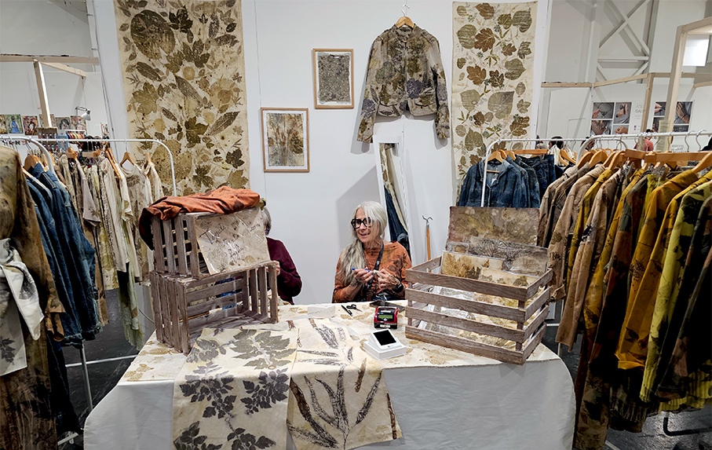

**LALAZOO ARTELIER** - _Tintura Naturale_ Crea oggetti tessili con fibre naturali e ogni pezzo è tinto con colori naturali e con ciò che la Natura offre grazie a tecniche come l’ecoprint o stampa botanica, lo Shibori, gli inchiostri vegetali, l’indaco.

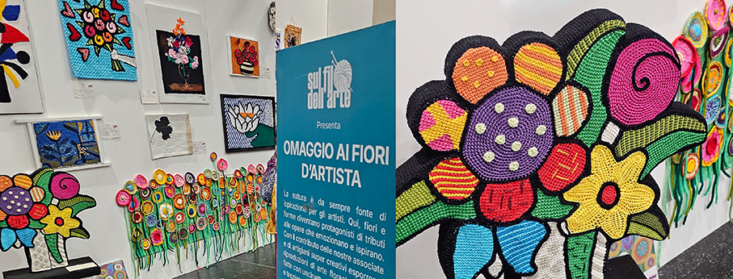

Grande risalto è stato dato all'arte tessile con la mostra **Omaggio ai Fiori d'Artista**, curata dall'**Associazione Sul Filo dell'Arte**. Si tratta di un'installazione collettiva e in divenire dove fiori e forme sono diventati un tributo alle grandi opere artistiche attraverso riproduzioni 2D e 3D realizzate ad uncinetto, ferri, telaio e ricamo.
L'esposizione era aperta anche alla partecipazione dei visitatori, che potevano portare in fiera il proprio contributo floreale fatto a mano. 

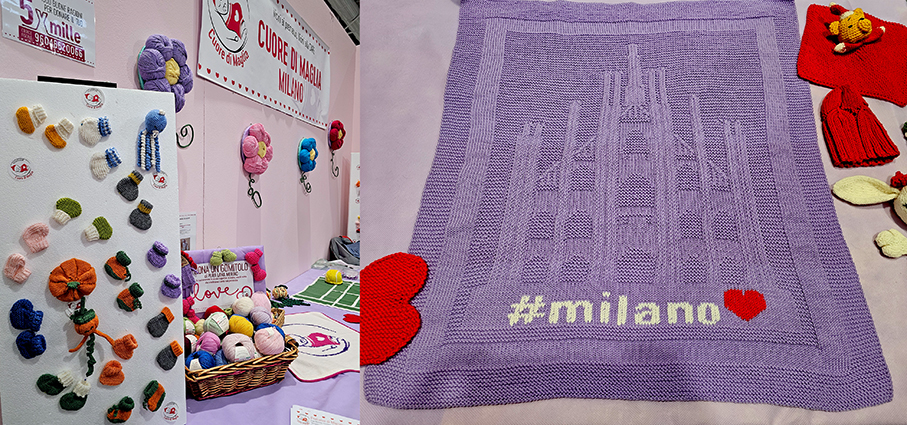

La dimensione etica e solidale del fare manuale ha trovato spazio nel lavoro dell'**Associazione Cuore di Maglia**, le cui volontarie hanno realizzato a maglia morbidi cappellini, scarpine e copertine destinati ai neonati di oltre 90 reparti di terapia intensiva neonatale in tutta Italia.

_Ph. Credits: Maria Rosa Sirotti_

