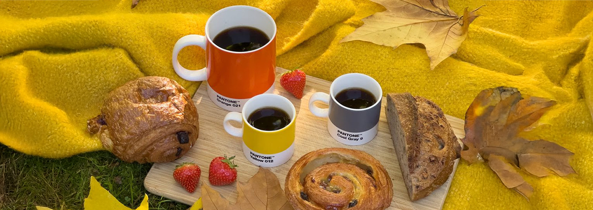
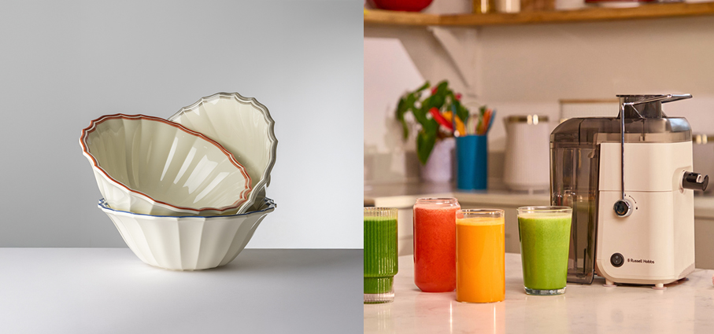
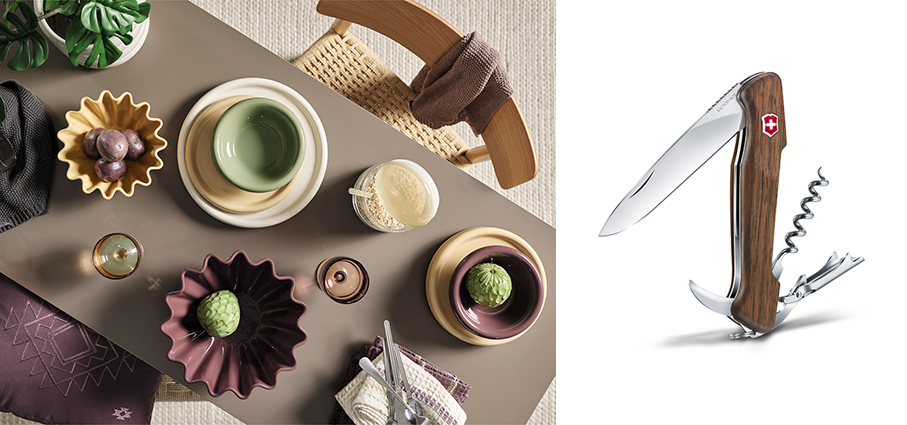
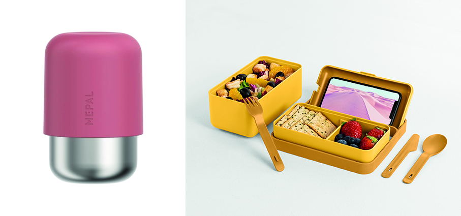
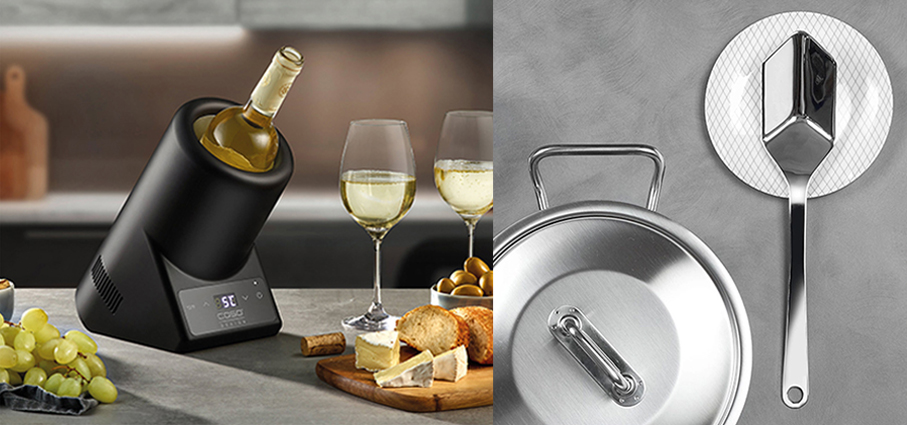
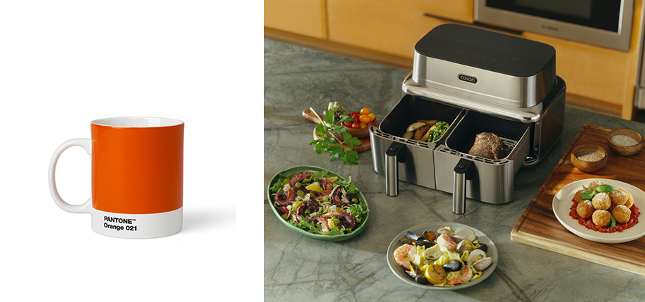
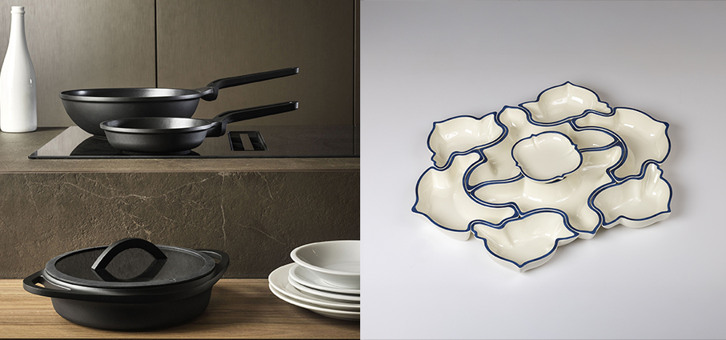
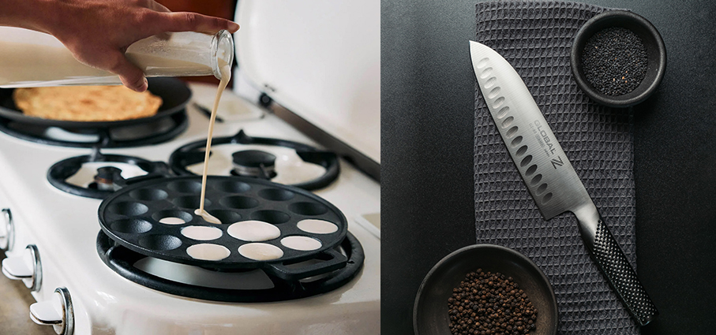

# Autunno in tavola e in cucina

>Nuove proposte per la **tavola, accessori e piccoli elettrodomestici** per divertirsi in cucina e con gli amici

_di Maria Rosa Sirotti_

**Eva** di **Mario Luca Giusti** insalatiere in melamina. La forma ampia e avvolgente, generosa nelle dimensioni e impreziosita da un raffinato fondo color avorio, è definita da bordi delicatamente ondulati che ne esaltano il carattere decorativo. Una palette di tonalità a contrasto – dal verde brillante al rosso, dal grigio al turchese – dona alla collezione un accento cromatico deciso e contemporaneo, trasformando ogni elemento in un raffinato protagonista della tavola.

**JuiceLuxe™** di **Russell Hobbs®** Per chi non si accontenta di semplici succhi salutari e nutrienti, ma ricerca anche una centrifuga facile e intuitiva da usare, con un design accattivante da esporre in cucina. Disponibile nella versione Stone e Raspberry. Il succo ottenuto fuoriesce dal beccuccio direttamente nel bicchiere pronto da servire, mentre la polpa viene espulsa nell’apposito contenitore. La polpa può essere infatti utilizzata per preparare zuppe, spalmata sul pane oppure disidratata per ottenere snack salutari ed energy boost.

**Malik - Nordic Mood** di **Jysk** propone un autunno dalle atmosfere raffinate, arricchendo la propria palette cromatica con la nuova collezione, che introduce colori come verde, giallo e viola in un nuovo assortimento per la tavola dal carattere grafico. Lo stile di arredo della stagione vede tonalità polverose abbinate ad
elementi cromati a specchio, che creano un contrasto sofisticato tra calore naturale e finish lucidi, uno degli accostamenti più attuali nell'arredo contemporaneo. In gres porcellanato lavabile in lavastoviglie.

**Wine Master** di **Victorinox** è Il multiuso pensato per gli appassionati di vino che racchiude in un unico strumento diverse funzioni dedicate per accompagnare il momento dell’apertura. Il lungo cavatappi e la lama dedicata al taglio della capsula si inseriscono nella filosofia del celebre marchio svizzero, dove funzionalità e affidabilità sono progettate per essere portate sempre con sé. In legno di noce e di ulivo per le guance da 13 cm e il cuoio per il fodero. Una soluzione particolarmente interessante per chi vive il vino non soltanto tra le mura domestiche, ma anche durante degustazioni, viaggi, picnic e occasioni conviviali. Distribuito e venduto da Künzi.

**Ellipse** di **Mepal** Tazza da caffè riutilizzabile da asporto color Malva. Realizzata in acciaio inossidabile riciclato al 90%, a doppia parete per mantenere le bevande calde per 30 minuti, a prova di perdite dopo l'uso, lavabile in lavastoviglie e di dimensioni adatte alla maggior parte delle macchine da caffè e dei porta bicchieri. Capacità 300 ml.

**Bauletto** di **Blim Plus** Reinterpretazione del classico portapranzo, con un design curato e innovative peculiarità, è composto da due capienti contenitori in polipropilene riciclabile, uno più alto e uno più basso con separatore, un coperchio ermetico che può diventare un pratico supporto per cellulare corredato di foro per il cavo di ricarica o per le cuffie, un set di posate, una cinghia gommata ripiegabile. Disponibile in 6 colori matt e 2 misure (uno o due contenitori), è inoltre corredato di valvola di sfiato che migliora
la resa in microonde, mentre le posate occupano il minimo spazio una sull’altra. 

**Raffreddatore** di **Caso Design** Il raffreddatore di vino mantiene una bottiglia pre-raffreddata tra 5–18 °C. Anche il vino frizzante, lo champagne o una bottiglia di acqua rimangono alla temperatura ideale per bere. Un display LED mostra la temperatura selezionata. Inoltre, sono dotati della tecnologia Peltier integrata che garantisce un funzionamento piacevolmente silenzioso. Distribuito e venduto da Künzi.

**Spuc** di **Pinti** è il mestolo multifunzione firmato dal designer francese Bruno Lefebvre. Con una sola mossa, consente di spostare, raccogliere e versare, unendo 3 funzioni in un unico utensile disponibile sia in acciaio inox 18/10 sia in nylon nero.

**Mug - Pantone** Lifestyle Collection Una pausa, ma a colori. Le mug e le tazzine espresso trasformano il rito del caffè e delle bevande calde in una piccola dichiarazione cromatica. Da scegliere nella propria tonalità preferita — o da collezionare. Distribuzione Moroni Gomma. 

**Iconic Dual** di **Cosori** la friggitrice ad aria premium dotata di due zone di cottura controllabili in maniera indipendente. Il modello combina un design premium, caratterizzato da una struttura in acciaio inox e pannello in vetro, con materiali privi di PFAS e un controllo intelligente tramite l’app VeSync. Funzioni come Sync e Match consentono di preparare contemporaneamente pietanze diverse, offrendo maggiore flessibilità e praticità in cucina. 

**Bianca** di **Mario Luca Giusti**, un originale centrotavola composto da un’elegante alzata al centro e da otto piatti ad incastro dalle forme differenti, pensati per dialogare tra loro e creare una composizione dinamica e armoniosa. Realizzato interamente in melamina, il set coniuga estetica e funzionalità, valorizzando la tavola attraverso un gioco di volumi, geometrie e sovrapposizioni. Le diverse sagome dei piatti permettono di interpretare il centrotavola in molteplici configurazioni, trasformandolo in un elemento decorativo versatile, capace di adattarsi a occasioni e mise en place differenti.

**Collezione Fusioni** di **Pinti** affronta la sfida di fondere la ricerca espressiva e formale con la tecnica produttiva. La scelta della pressofusione dell'alluminio permette di realizzare strutture monoblocco prive di elementi aggiunti o saldature, caratterizzate da superfici continue, solidità e forte valore plastico. Per la linea di padelle, la continuità stilistica è garantita da un manico riportato integrato su un corpo ottenuto ottimizzando uno stampo esistente, a dimostrazione di una progettazione virtuosa e attenta ai processi.

**Cast Iron** di **Skottsberg** Padella per mini pancakes. Robusta e durevole, è realizzata in un unico pezzo di ghisa resistente all’usura. Si può utilizzare piano ad induzione, sulla griglia, sul fuoco vivo e in forno. Distribuita da Schoenhuber.

**GZ-80** di **Global** Il nuovo santoku in Limited Edition progettato per chi esige il massimo da ogni taglio. Una lama alveolata che crea piccole sacche d’aria durante il taglio che riducono l’attrito e facilitano il distaccamento del cibo dalla lama. Che si tratti di affettare, sminuzzare o tritare carne, pesce o vegetali assicura altissima precisione e grande fluidità in ogni gesto. Realizzato in Cromova 18, l’esclusiva lega di acciaio inox sviluppata da Yoshikin e caratterizzata dalla presenza di cromo, molibdeno e vanadio. 

