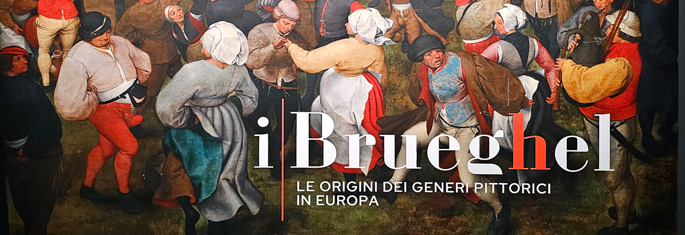
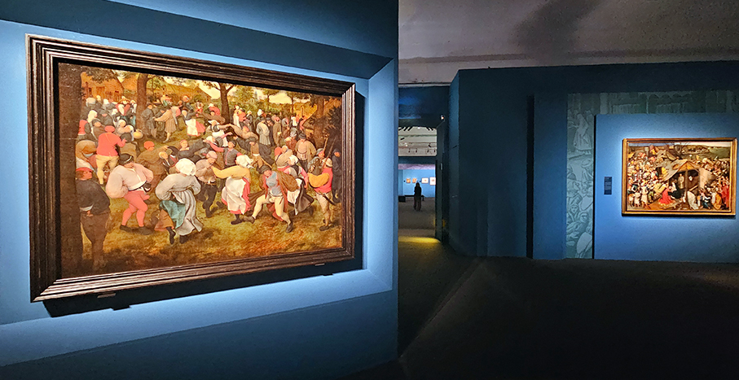
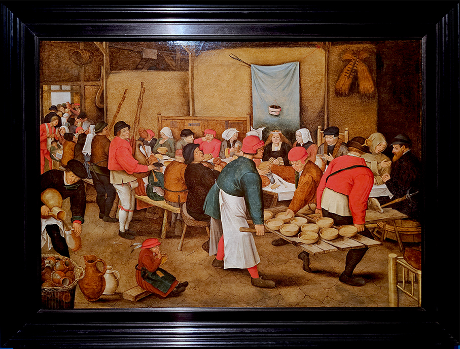
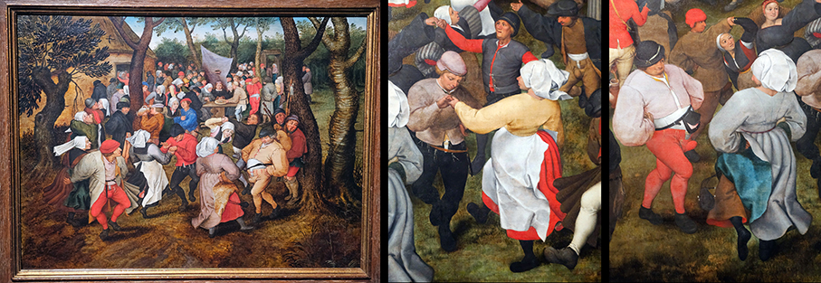
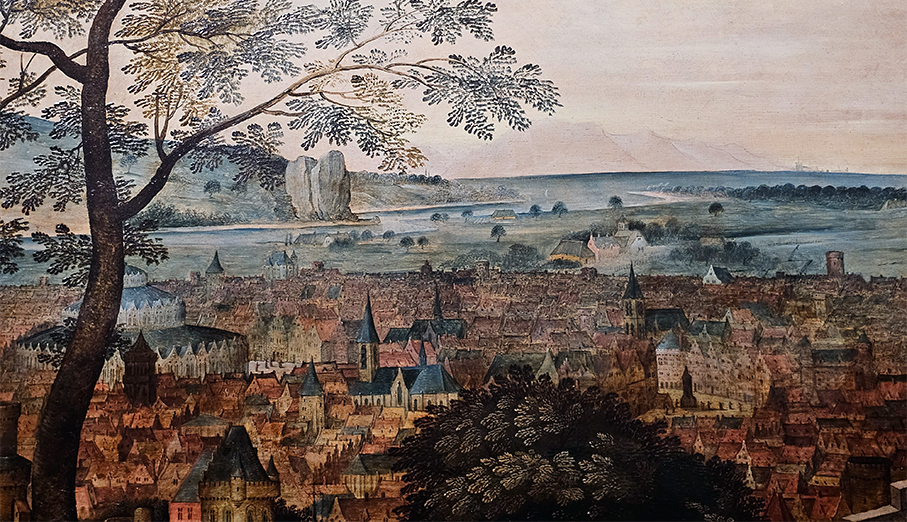
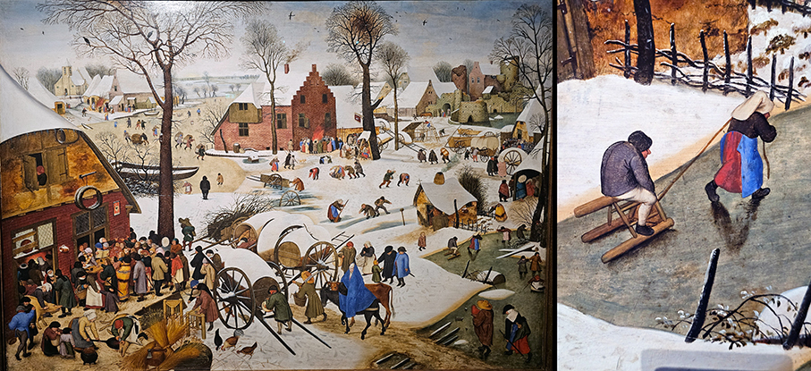
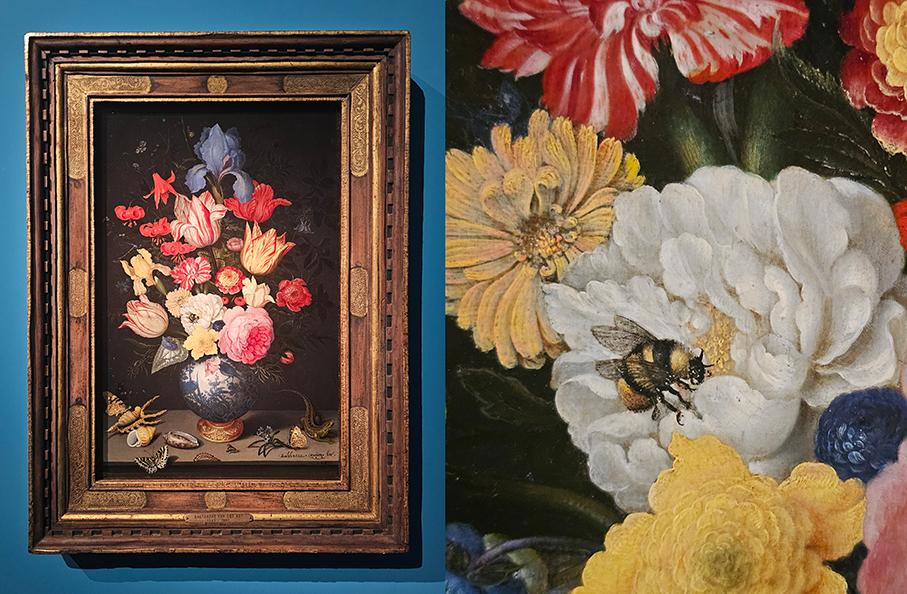
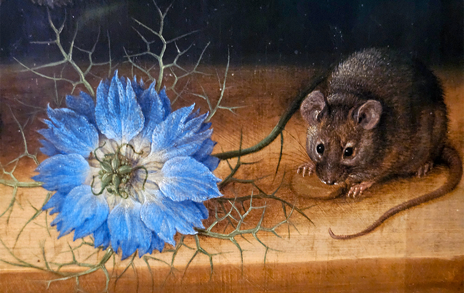
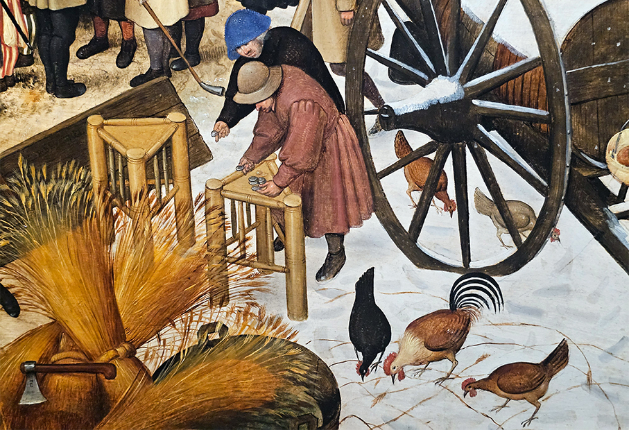

# I Brueghel e le origini dei generi pittorici in Europa

>**A Palazzo Reale di Milano** “I Brueghel. Le origini dei generi pittorici in Europa”, la mostra dedicata a **una delle più influenti dinastie artistiche** del Rinascimento europeo

_di Maria Rosa Sirotti_

In programma **dal 29 settembre 2026 al 31 gennaio 2027**, la mostra accompagna il visitatore in un percorso storico e artistico attraverso **oltre 80 opere tra dipinti, disegni e stampe**, alla scoperta di una “dinastia” di pittori che contribuì in modo decisivo, nei Paesi Bassi, in Italia e nel resto d’Europa, alla nascita dei futuri ‘generi pittorici’. **Dai paesaggi innevati alle burrasche, dalle nature morte alla vita contadina fino alle battaglie**, il sistema dei generi pittorici darà forma alla pittura moderna europea così come la conosciamo oggi. 

Promossa da **Comune di Milano – Cultura e prodotta da Palazzo Reale e 24 ORE Cultura – Gruppo Il Sole 24 ORE**, è un progetto a firma di **Bernard Aikema**, con la curatela di **Carlotta Striolo**. 

Partendo dal capostipite, il grande **Pieter Bruegel il Vecchio**, che inaugura una nuova pittura in cui il popolo diventa per la prima volta protagonista assoluto, si approfondisce il consolidarsi del “brand Brueghel” con la conseguente espansione sul mercato sotto la guida del primogenito **Pieter Brueghel il Giovane**, a capo di una fruttuosa bottega. Emerge poi come assoluto protagonista **Jan Brueghel il Vecchio**, il cosmopolita secondogenito che studiò la maniera italiana, conquistando committenze prestigiose, come il cardinale Federico Borromeo arcivescovo di Milano, primo grande collezionista di pittura fiamminga in Italia.

**L’inizio del XVII secolo** segnò un periodo di cambiamenti culturali, sociali ed economici. Lo sviluppo di un nuovo e più ampio mercato dell’arte — non più limitato a committenze religiose e nobiliari, ma sempre più aperto, soprattutto in Olanda, a un pubblico “borghese” — favorì una progressiva specializzazione della produzione pittorica: gli artisti iniziarono a rivolgersi a precise nicchie di mercato, dedicandosi a soggetti specifici e particolarmente richiesti da un vasto pubblico. In questo processo decisivo il “brand Brueghel” avrà un ruolo assolutamente centrale. 

S’inserisce così nel grande filone dei **paesaggisti fiamminghi** e allo stesso tempo inaugura una nuova pittura in cui il **popolo — contadini, bambini, festanti — diventa per la prima volta protagonista assoluto**.

"_È un mondo caleidoscopico, immensamente variegato, quello dei Brueg(h)el, ma contraddistinto da alcuni tratti essenziali: anzitutto i formati delle opere, che con poche eccezioni tendono a essere di grandezza media o piccola_ commenta **Bernard Aikema**. _Manca poi il protagonista principale, la figura centrale che crea e determina con la sua predominanza fisica lo spazio pittorico, al contrario di quanto invece avveniva nelle opere di stampo classicista. I personaggi di notevole presenza fisica, posizionati più o meno al centro dell’immagine, non sono mai dominanti. La maggior parte delle opere bruegeliane, invece, raffigura scorci di paesaggio con una proliferazione di soggetti naturali, fra animali di tutte le specie (anche esotiche) e un’abbondante vegetazione di alberi, cespugli, piante, fiori_". 

**Un insieme di microcosmi che vanno letteralmente guardati da vicino**, molto vicino, analizzando tutti i particolari: "_È un universo in miniatura, popolato da molte, moltissime figure e figurine, attorniate dai più diversi tipi di oggetti domestici, strumenti di lavoro ed altro – il tutto situato in contesti rurali costellati da una varietà infinita di abitazioni, capannoni, mulini, cappelle, chiese e castelli_- prosegue Aikema - _e lo spettatore deve esplorare l’organizzazione interna dei dipinti, suddivisa fra figure umane che vedono certi eventi che si svolgono nella loro immediata vicinanza, e quelle che invece non li vedono (o non vogliono vederli, impegnate magari in altre attività che, in un modo o altro, sarebbero collegabili con la scena principale). In una dialettica figurativa fra consapevolezza/compartecipazione e ignoranza/indifferenza_.

**INFORMAZIONI E PRENOTAZIONI**

Palazzo Reale, Piazza del Duomo 12, Milano – sala piano terra

29 settembre 2026 – 31 gennaio 2027

+39 02 54912 (attivo dal lunedì al sabato 

dalle ore 9:30 alle ore 17:30).

palazzorealemilano.it | 

mostraibrueghelmilano.it

vivaticket.com