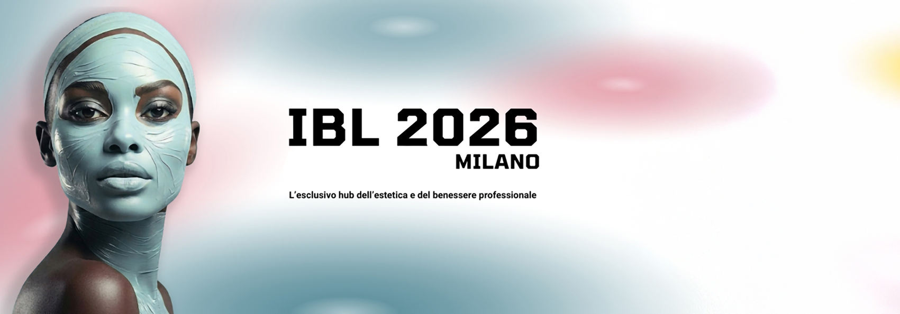
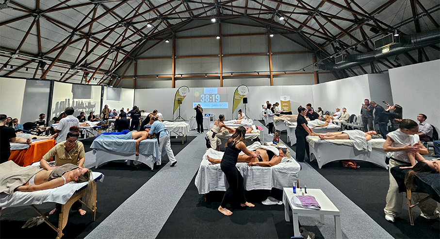
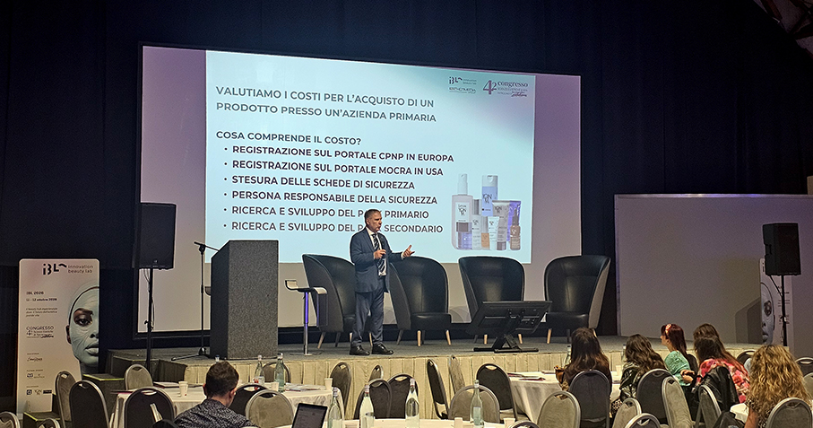
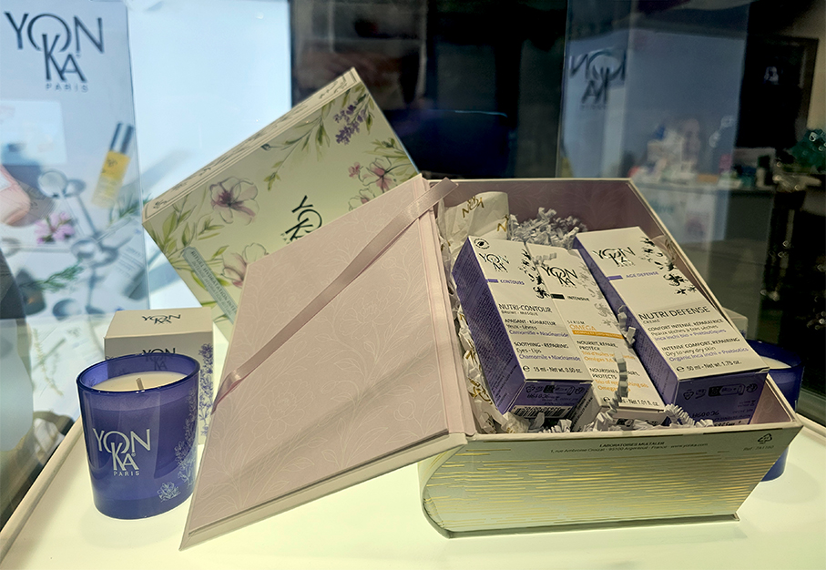
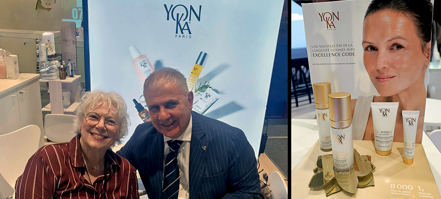
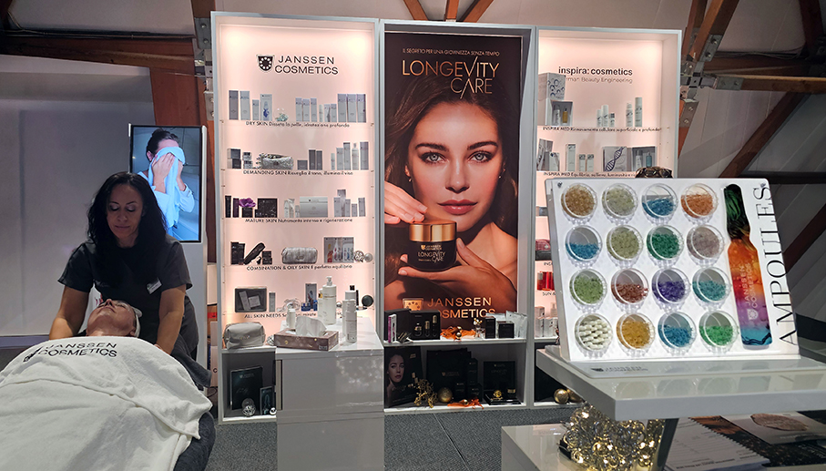
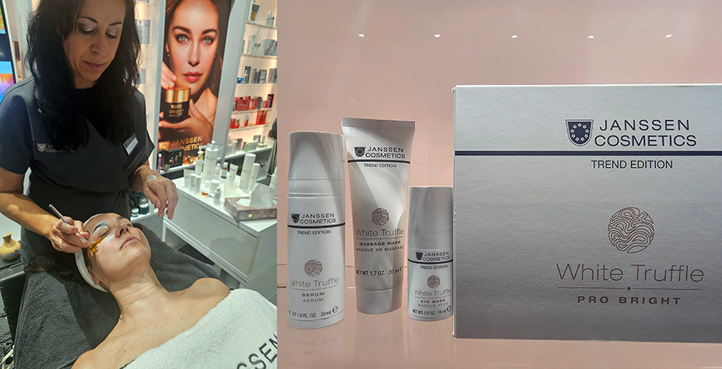
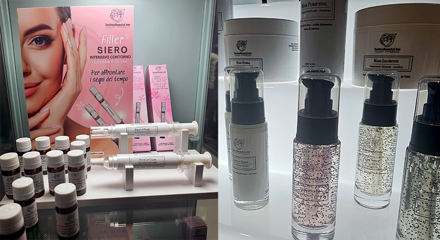
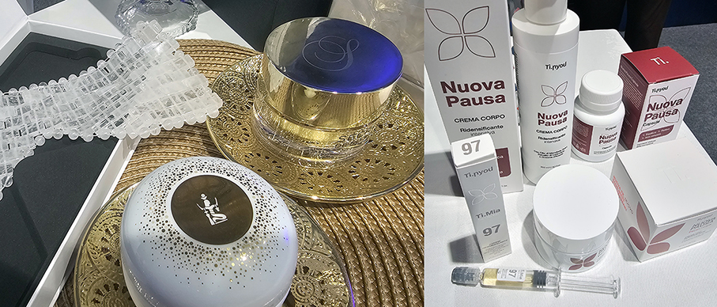
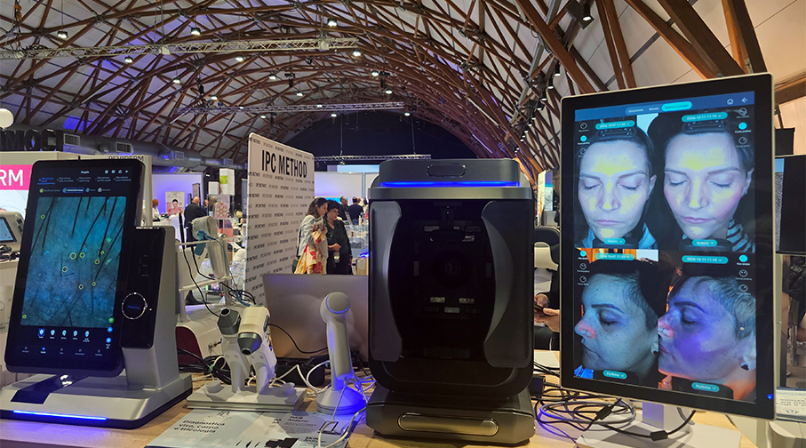

# IBL Innovation Beauty Lab 2026

>Il **beauty hub esperienziale** organizzato da **Esthetimedia Group** per la nuova estetica professionale tra scienza e visione strategica

_di Maria Rosa Sirotti_

Si è svolto a Milano **IBL Innovation Beauty Lab**, l’evento esclusivo per l’estetica e il benessere professionale,  riservato a **estetiste, operatori del benessere e del mercato professionale**. 
Un programma ricco, di alto livello costruito per **valorizzare il ruolo dell’estetista** come vera e propria guida per il benessere consapevole del consumatore.
Più di **70 brand espositivi** e più di **50 relatori** autorevoli provenienti da tutta Italia. 

**C.I.M. (Campionato Italiano Massaggi)**

Grazie alla partnership esclusiva di Esthetimedia Group con CIM, si è svolta la tappa **categoria Massaggi Estetici**, 
che si è arricchita di quattro criteri specifici: **flow, cura del cliente, intenzione e tecnica efficace**, elementi che devono convivere nei 45 minuti della performance. 

Cuore strategico, scientifico e formativo dell’evento è stato il **Congresso di Scienze Estetiche & Spa**, patrocinato da Les Nouvelles Esthétiques Italia. Un grande numero di professionisti hanno tenuto **sessioni di approfondimento scientifico, tecnico e manageriale** come esperti del settore medico-scientifico, dell’estetica professionale, del benessere, del business e della comunicazione. 

“_Un grande congresso non serve a confermare ciò che già si sa, ma a esplorare ciò che sta cambiando_”, sottolinea **Francesca Frediani, Direttrice Responsabile di Les Nouvelles Esthétiques Italia e conduttrice** delle due giornate congressuali. “_La cliente contemporanea non è più interpretabile attraverso categorie rigide. Oggi la pelle è il punto di emersione di complessi equilibri interni e il nostro obiettivo è offrire ai professionisti una nuova grammatica mentale, scientifica e strategica_”.

**EXPERIENCE HUB** 
 
Un’area espositiva, un percorso immersivo dedicato alle novità di settore in cui toccare con mano l’**eccellenza cosmetica, tecnologica e formativa**, scoprire in anteprima i **protocolli più innovativi** e vivere dal vivo **dimostrazioni pratiche**. Una selezione esclusiva di **brand leader** della cosmesi, delle tecnologie estetiche e della formazione professionale.

**Yo-nka**

Un marchio professionale francese per la cura della pelle che fornisce una risposta alternativa efficace e un complemento importante alle tecniche estetiche mediche, garantendo risultati visibili e duraturi con trattamenti non aggressivi. In pratica, una **alternativa fito-aromatica alle procedure estetiche invasive**.

Nella gamma prodotti si trovano, dalla radice al seme, **più di 130 piante** provenienti da tutto il mondo. Yon-Ka fa affidamento sul potere degli oli essenziali e degli estratti vegetali combinati con attivi “gold standard” come acido ialuronico, vitamina C, polifenoli, peptidi e AHA per combattere l’invecchiamento della pelle e affrontare tutti i potenziali problemi della pelle. 
Come mi racconta **Angelo Sciarra, Consulente Commerciale di Yonka**, ogni prodotto mira ad aiutare la pelle a resistere allo scorrere del tempo nel modo più appropriato, con linee specifiche dedicate alle varie zone.

La **linea Contours** è dedicata a **occhi e labbra**, rispondendo alle esigenze specifiche delle zone più fragili del viso,  con olio di nocciola,acidi della frutta, mimosa e rosmarino.
La **linea Age Defense** permette alla pelle di combattere l’invecchiamento fornendole i mezzi naturali per ritrovare equilibrio e energia vitale.
**Excellence Code** è una linea ispirata alla scienza della longevità la cui anima botanica è incarnata dall'**estratto brevettato di Gelsomino Fito – Fermentato** di Grasse, Francia. 

**Janssen Cosmetics**

Un brand tedesco che progetta ogni prodotto per rispondere a specifiche esigenze della pelle e trattare inestetismi di vario tipo, garantendo trattamenti personalizzati e risultati visibili. Dal 1995, la linea è ***ufficialmente riconosciuta come Cosmeceutica**, un traguardo che testimonia la qualità e l’efficacia dei suoi trattamenti. Non solo skincare domiciliare, ma protocolli professionali per gli Istituto di Bellezza: **trattamenti mirati, efficaci e piacevoli**, combinando scienza e benessere.

**Ampoules** è una vasta gamma di concentrati di principi attivi selezionati in forma di ampolla. Le fiale sono un'applicazione dosata per un trattamento e deve essere utilizzata completamente. I concentrati in fiala migliorano i cosmetici di base e aumentano il loro effetto.

**White Truffle Pro Bright Treatment** è l’ultima novità, una linea premium dedicata al **tartufo bianco**, un ingrediente raro  e uno dei tesori più preziosi della natura: contiene ceramidi, vitamine C, D e B. Il trattamento offre una esperienza esclusiva, combinando rigenerazione, nutrimento profondo e luminosità visibile. Il trattamento può essere prolungato a casa grazie alla **White Truffle Eye Mask**, una lussuosa maschera che rende il contorno occhi più levigato, fresco e meno stanco.

**Techno Beauty Line** 

Soluzioni professionali e all’avanguardia nel settore Estetica, che uniscono la qualità della **cosmetica Made in Italy** con la **tecnologia più innovativa**. Le linee viso sono formulate per rispondere alle esigenze di ogni tipo di pelle: dalla detersione all’idratazione, dal trattamento anti-age alla luminosità quotidiana. Utilizza ingredienti attivi di alta qualità come **Acido Ialuronico, Vitamine, Collagene ed Estratti Naturali**.

**Beads** è la linea viso innovativa che contiene **vitamine pure incapsulate in raffinate microsfere colorate**. Ogni trattamento combina texture sensoriali e principi attivi naturali. Le microsfere vitaminiche si attivano al contatto con la pelle, rilasciando gradualmente le vitamine in esse contenute per un’azione mirata e prolungata.

**Eye & Lip Filler** è un siero intensivo contorno occhi e labbra con Acido Ialuronico, Caffeina, Aloe Vera ed Estratto di Caprifoglio che, in sinergia tra loro, formano un film superficiale non occludente capace di idratare la cute. Penetra negli strati superficiali della pelle distendendo le rughe, sgonfiando le borse, tonificando la pelle e stimolando la sintesi di collagene ed elastina.

**Sothys**

La filosofia di Sothys è incentrata sull'offrire un’esperienza di trattamento supportata da una **tecnica impeccabile** e da un'autentica **esperienza sensoriale**. Sviluppa nuove e avanzate soluzioni cosmetiche sia per soin in cabina sia domiciliari. È nei **laboratori Soredec**, cuore della Ricerca Avanzata Sothys, che prendono vita tutte le soluzioni di bellezza.

**Secrets de Sothys™** è la linea d'eccellenza, per chi cerca il meglio per la pelle senza rinuciare a sensorialità e ricercatezza della texture. 

**La Crème 128** contiene un esclusivo duo di cellule staminali di **Rosa Sothys** e olio prezioso di **Fiore di Porcellana**, vero architetto della bellezza per ripristinare l'integrità cutanea con la sua azione riparatrice. 

**Ti.nyou**

Il Metodo Ti.nyou è un percorso di rimodellamento completo. Il cofanetto **Nuova Pausa 21** è stato creato per offrire un supporto completo e naturale durante la **menopausa**. Grazie alla combinazione delle **Caps e della Tisana**,  agisce per alleviarne i disturbi tipici e migliorare il benessere generale grazie ad un approccio olistico.

I principi attivi contenuti negli estratti vegetali, come i **fitoestrogeni del trifoglio rosso e le procianidine dei semi d’uva**, aiutano a ridurre le vampate di calore, migliorare l’elasticità e la salute della pelle. Estratti di zenzero e  collagene idrolizzato migliorano la funzione epatica, accelerano il metabolismo e tonificano il corpo, contribuendo a un effetto snellente e a una pelle più compatta.

**Business Group**

Business Group srl è un azienda leader nella produzione e distribuzione di **apparecchiature estetiche per diagnostica viso, corpo e tricologia**.
Lo **Skin Analyzer** è in grado di fornire ben 14 analisi degli inestetismi: sebo, pori, acne, rughe, macchie, colorito, pigmentazione, idratazione, sensibilità cutanea, macchie scure, collagene, punti neri e bianchi, luminosità, occhiaie. Il display da 21,5 pollici garantisce scatti tridimensionali (frontale e laterale).
La telecamera esterna optional è ideale per rilevamenti macro per cute e cuoio capelluto e rilevamento dell’ idratazione superficiale.

_Ph.Credits: Maria Rosa Sirotti_