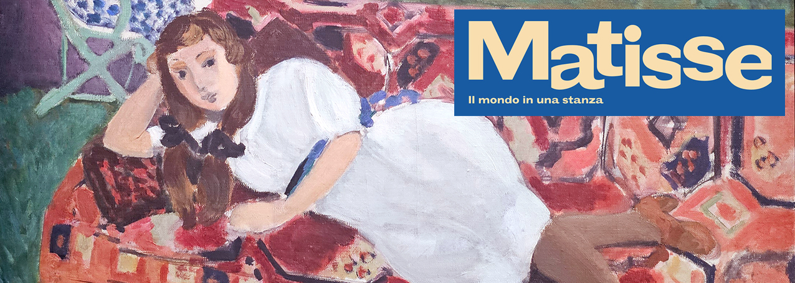
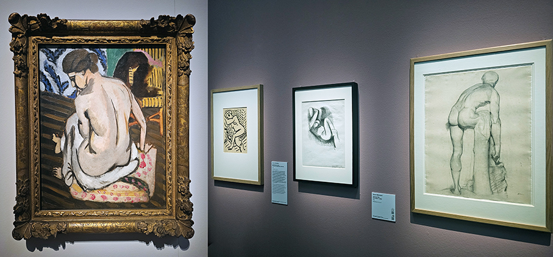
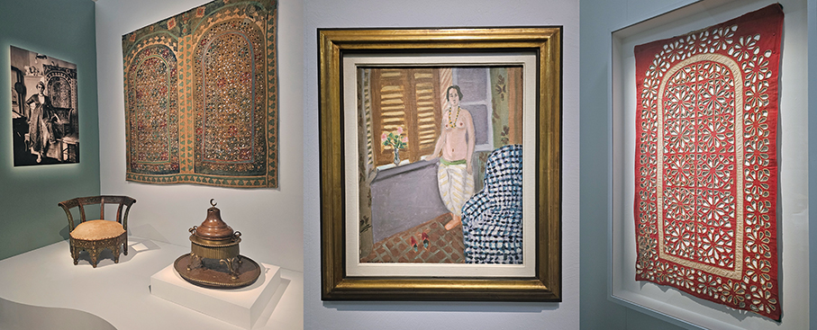
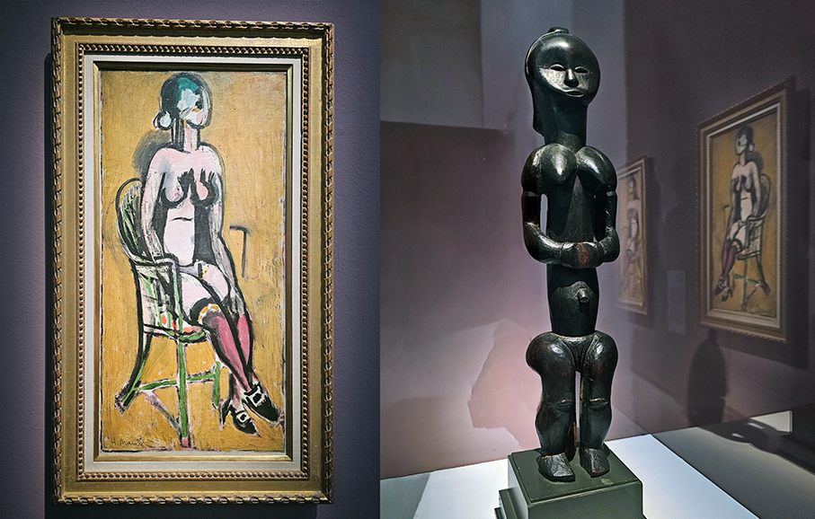
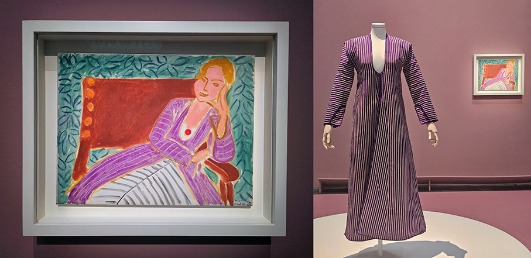
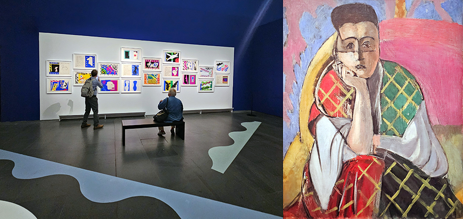
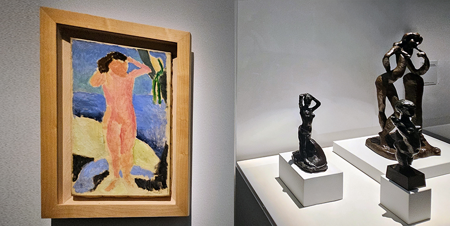
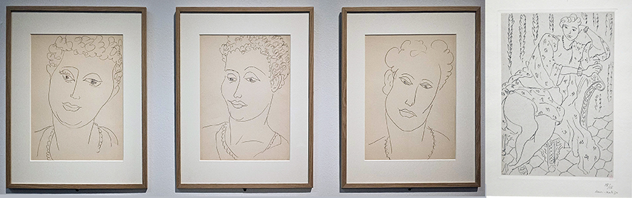
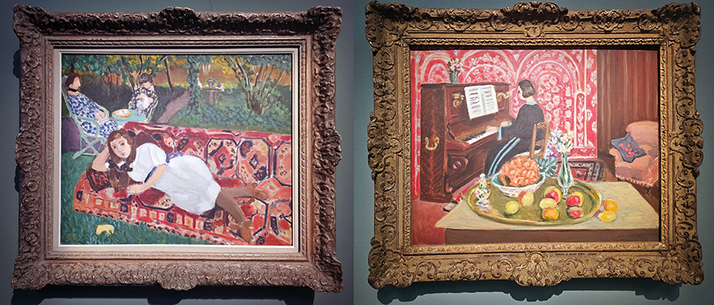
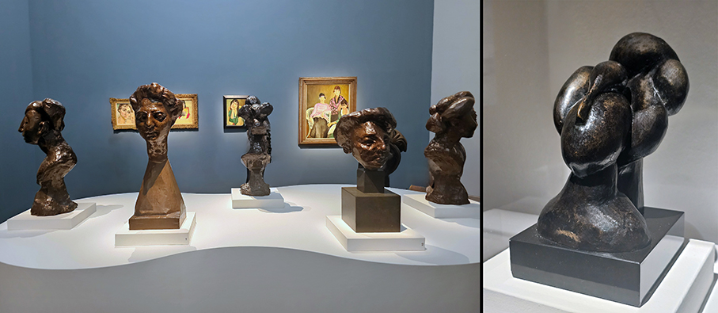

# Matisse. Il mondo in una stanza

>L’arte africana, islamica, russa, cinese e del Pacifico hanno influenzato il linguaggio di Matisse, ridefinendo i confini stessi del **modernismo occidentale**

_di Maria Rosa Sirotti_

Con **Matisse. Il mondo in una stanza**, fino al **21 Febbraio 2027**, il **MUDEC - Museo delle Culture** presenta un progetto espositivo sul **rapporto tra Henri Matisse e le culture extra-europee** che l’artista incontrò nel corso dei suoi studi e delle sue spedizioni. Il percorso riunisce circa **100 opere tra dipinti, lavori su carta, sculture e fotografie**, provenienti da prestigiosi istituti internazionali abbracciando l'intero arco dell’opera dell'artista **in 8 sezioni**, ciascuna delle quali analizza un tema chiave nell’evoluzione della sua ricerca.

Dai capolavori di **nudo femminile** come il Nudo seduto di schiena del 1917, in arrivo dal Philadelphia Museum of Art, o i nudi giovanili concessi dalla Pierre and Tana Matisse Foundation di New York, ai **ritratti** come La Femme au voile dal MoMA di New York e tanti altri, si alle **sculture della serie Jeannette** e ai **lavori su carta**, fino all'ultimo dipinto di Matisse: **Femme à la gandoura bleue**.

A queste opere, si affianca una **collezione rara e ricchissima di oggetti e tessuti**: non opere di contorno, ma interlocutori cruciali, preziosi compagni di una vita che permettono di ricostruire la trama dei debiti e dei dialoghi intessuti da Matisse con **l'arte e il design di altre geografie**. Matisse amava circondarsene nelle stanze della sua quotidianità, attivando quell’atmosfera multisensoriale tipica dei suoi atelier. 

Al centro del rapporto di Matisse con il mondo esterno c'erano le **modelle internazionali** che posavano nel suo studio, le cui identità etniche e culturali erano spesso trasformate da abiti regionali, folcloristici o di alta moda.

_Matisse. Il mondo in una stanza_ si propone come **punto di riferimento nella rivalutazione critica dei concetti di alterità, primitivismo e orientalismo**, con ripercussioni che vanno ben oltre il campo della storia dell'arte. 
La mostra si inserisce nel dibattito in atto sui **rapporti tra arte moderna, nazionalismo e cultura coloniale**. 
Infine, il pensiero di Matisse sul ruolo dell'artista e sulla **funzione sociale dell'arte** rende questa mostra quanto mai attuale. 

Il percorso guida il visitatore lungo il processo creativo del maestro e lo invita a una **riflessione su come l’arte possa attivare punti di contatto al di là dei confini** e invitando a compiere una necessaria revisione critica delle appropriazioni di Matisse da una prospettiva postcoloniale.

“_Con questa mostra il MUDEC propone una mostra che invita a rileggere l’opera di Matisse da una prospettiva nuova. Attraverso capolavori e oggetti provenienti da importanti collezioni internazionali, il percorso mette in luce il dialogo che l’artista ha intrecciato con culture e tradizioni di diverse parti del mondo. Una mostra che parla di arte, ma anche di incontro, scambio e apertura, confermando il ruolo del MUDEC come luogo di confronto tra culture e quello di Milano come città internazionale e inclusiva_”, ha affermato l’**assessore alla Cultura del Comune di Milano Tommaso Sacchi**.

Matisse attinse all’**estetica orientale** per condurre riflessioni proprie sui temi della decorazione, della bidimensionalità, del rapporto linea-colore o della luce di cui sentiva l’urgenza ben prima dei viaggi in **Algeria, Andalusia o Marocco**.

L'**arte cinese** offrì a Matisse una ricchezza di spunti per un impegno durato tutta la vita, volto a **smantellare le gerarchie dell'arte europea e a concentrarsi sul tema eterno dell’essenzialità** che si manifesta nella purezza della linea e nella potenza del simbolo. 

Matisse partì per **Tahiti** nel 1930 e le sue opere successive facevano ripetutamente riferimento a **fiori di tiaré**, a uccelli, alghe, meduse, attinti dai ricordi profondie sedimentati nell’intimo.

Il percorso della mostra si conclude davanti all’ultimo quadro realizzato da Matisse e alla sua ultima scultura, **Femme à la gandoura bleue** e il **bronzo dedicato a Katia**.

La mostra, a cura di **Ellen McBreen e Chiara Gatti**, prodotta da **24 ORE Cultura – Gruppo Il Sole 24 ORE** e promossa dal **Comune di Milano – Cultura**, è realizzata in collaborazione con il **Musée Matisse di Nizza** ed è sostenuta da **Unipol** come Main Sponsor e supportata come Sponsor da **Turisanda1924**, esclusivo brand di viaggi di Alpitour World, da **Enel** e da **BPER Banca**.

_Ph.Credits: Maria Rosa Sirotti_

**MUDEC**

Via Tortona 56, tel. 02/54917 (Lun-Ven 10.00-17.00)

Matisse. Il mondo in una stanza

fino al 21 Febbraio 2027