# Novità per la casa autunnale

>Accessori, Arredo e complementi, Design, Outdoor: tante le **novità per la casa autunnale**

_di Maria Rosa Sirotti_
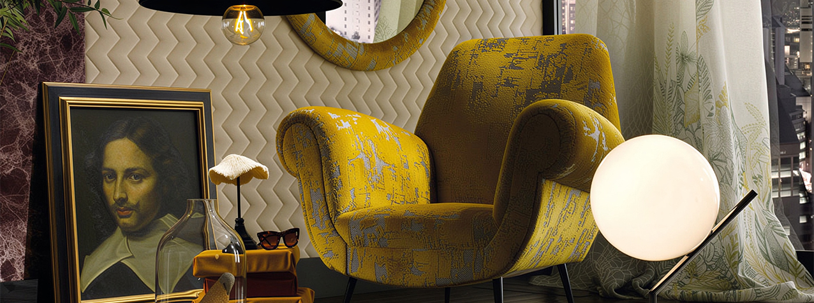

**Flamenco** di **Zava** lampada da terra che trova il proprio equilibrio formale nell'accostamento delle parti, creando un effetto d'insieme armonioso pur nella disarmonia dei singoli elementi. Lo stelo esile e affusolato si innesta su una solida base materica, sintetizzando l'incontro tra la forza del metallo e l'impalpabile leggerezza della luce.  Oltre alle versioni in ferro, legno, cemento, ecomalta e ottone, la collezione valorizza l'impiego del marmo naturale, proposto nelle varianti Crema Olimpia e Black&Gold.

**Cervo** di **Fazzini** cuscini decorativi disponibili nelle misure 30x50 cm e 50x50 cm, portano negli ambienti il fascino autentico della natura. Il disegno, ispirato alla figura maestosa del cervo, si sviluppa su una superficie morbida e luminosa, creando un’atmosfera calda e avvolgente. I toni neutri e le sfumature delicate valorizzano ogni dettaglio, rendendo questi cuscini perfetti per arredare soggiorno e camera da letto con uno stile elegante e contemporaneo. Prezioso velluto - Stampa digitale. Rifinito con piccoli volani.

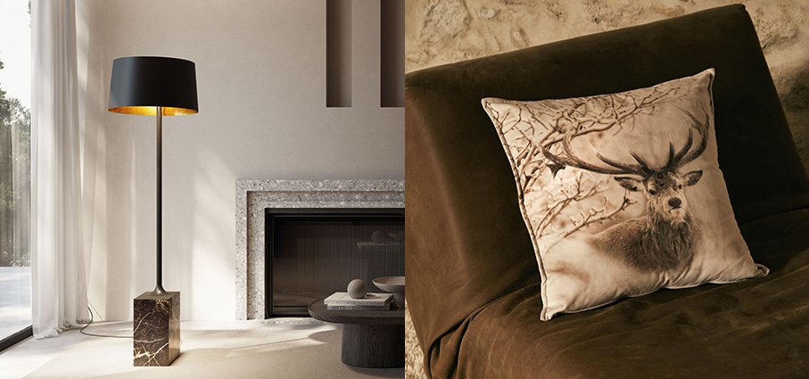

**Eva** di **Nodo Italia** poltrona realizzata in collaborazione con lo stilista Antonio Marras utilizzandio Olyna®, il filato proprietario sviluppato da Nodo Italia per unire estetica, performance, durabilità e sostenibilità.
Totalmente riciclabile, prodotto senza utilizzo di acqua nel processo produttivo e senza additivi chimici. Un materiale progettato per garantire elevate performance tecniche e una forte qualità estetica, capace di rispondere alle esigenze degli spazi contemporanei mantenendo un approccio responsabile verso l’ambiente.

**Alviero Martini 1A Classe** di **Caleffi Home Collection** combina design e qualità italiana grazie alla celebre stampa Geo, simbolo di eleganza e originalità. Biancheria letto di classeI completi letto – copripiumini, lenzuola e copriletti trapuntati – si distinguono per i tessuti premium come percalle e raso di cotone, e per le nuove varianti cromatiche come Geo Classic, Safari, Terracotta e Tortora. Ideali per chi cerca comfort, raffinatezza sartoriale e un tocco di esclusività.

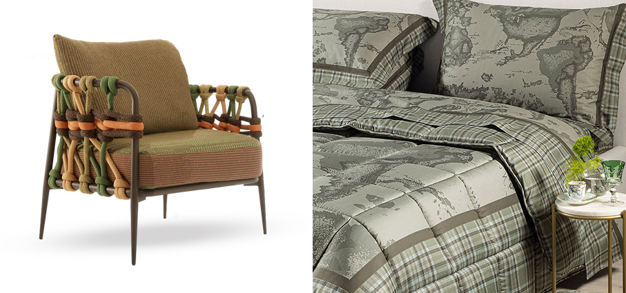

**Bliss** di **Rubinetterie Treemme** propone una raffinata reinterpretazione della tradizionale maniglia a quattro punte attraverso un disegno essenziale e contemporaneo. Un equilibrio tra il rigore della geometria e la fluidità organica della forma che si ritrova in ogni elemento della collezione: nelle proporzioni calibrate dei rubinetti a tre fori, nella purezza delle linee che dialoga con la precisione dei comandi separati, nella bocca di erogazione continua e armoniosa. Realizzata in acciaio, è proposta anche in finiture PVD.

**Floor** di **Globo** vasca freestanding simple fiber della collezione Bagno di Colore (BdC), il progetto esclusivo dell’azienda italiana che integra ceramica, arredo e architettura in un unico sistema. con caratteristica trama cannettata nella parte esterna e dalle dimensioni generose170×80 cm, interpreta il bagno come luogo di benessere contemporaneo: la sua presenza scultorea scandisce lo spazio con naturale equilibrio, mentre la continuità cromatica ne alleggerisce la percezione, integrandola nell'architettura complessiva.

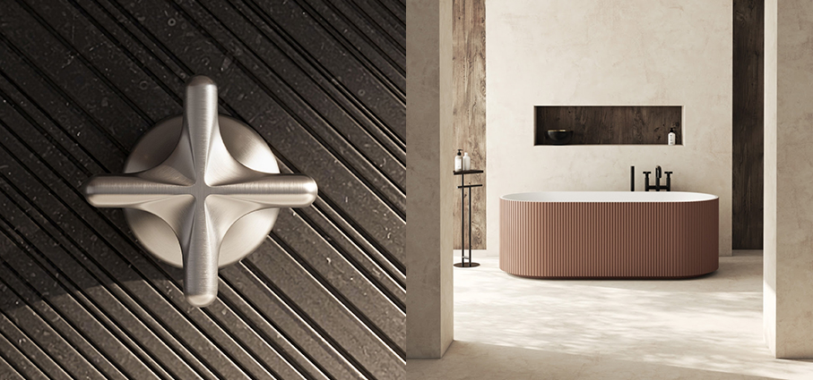

**Yamato** di **Fazzini** è una narrazione poetica cha ha come protagonista un cervo con il suo cucciolo, alcuni conigli che si nascondono tra le foglie, betulle dai tronchi bianchi, felci, fogliami mossi da un vento leggero. La parure copripiumino, il completo lenzuola e la trapunta mettono in scena la magia di un albo illustrato, in cui ogni elemento invita alla lentezza, alla cura, al respiro. Porta in casa il senso giapponese della natura come presenza spirituale.

**Florian** di **Jysk** Lampada a batterie progettata per creare un'atmosfera calda e accogliente nella casa. Grazie al design portatile, si può spostare facilmente e portare la luce dove più si ha bisogno. La lampada è dotata di due comandi separati. Il pulsante sotto il paralume controlla l'accensione e lo spegnimento, mentre il pulsante in alto permette di regolare l'intensità luminosa a seconda delle proprie esigenze. Offre fino a 3 ore di illuminazione alla massima intensità e fino a 15 ore al livello minimo. Materiale: acciaio. Colore marrone scuro.

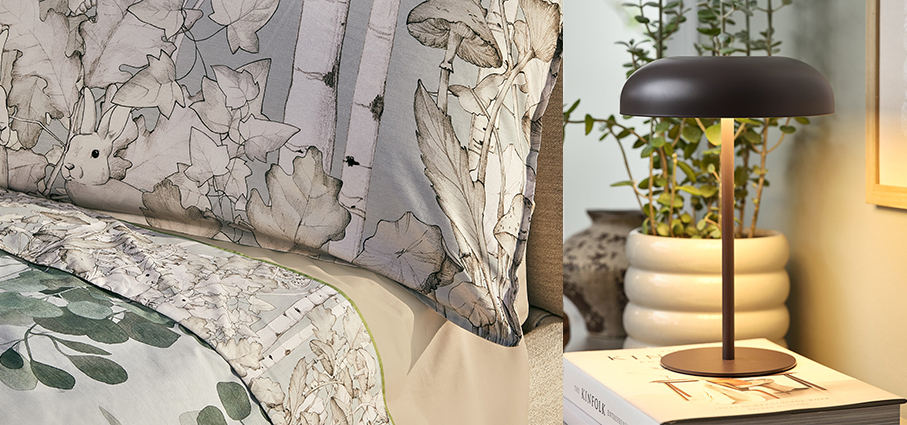

**Idrowood** di **Meg Living** è una collezione di pavimenti in legno idroresistente grazie al suo innovativo sistema di posa Megaloc Aqua Protect che lo rende incredibilmente resistente all'acqua, ai graffi, ai danni e all’alto calpestio persistente. Una soluzione pensata per chi desidera l’atmosfera calda e naturale del legno senza rinunciare alle performance richieste dagli spazi contemporanei. Si compone di legno certificato FSC proveniente da foreste gestite in maniera corretta e responsabile, secondo rigorosi standard ambientali, sociali ed economici. Rispetta un ciclo di riforestazione controllata, a garanzia di una scelta sostenibile per l’ambiente.

**Remmels** di **Jysk** porta la “zebra print”, uno dei trend più forti del momento, nel cuore del living. Insieme al cromo, è una novità dell’assortimento di arredo indoor stagionale della catena di design scandinavo. Poltrona in tessuto zebrato/cromato. Cuscini seduta e schienale in schiuma. Telaio cromato. 

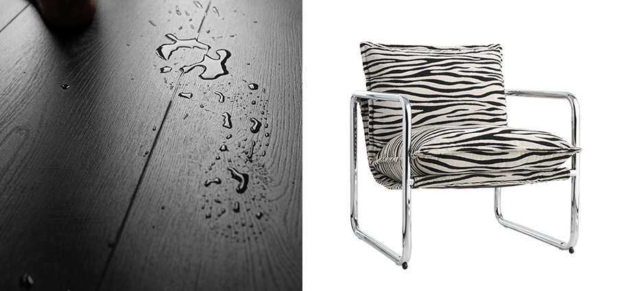

**Karlebjerg** di **Jysk** tavolino d'appoggio. I classici toni terrosi come il marrone e il verde  restano il cuore dello stile scandinavo autunnale, ma nel 2026 la palette si arricchisce di una distintiva tonalità melanzana. Il colore fa parte della tendenza Raw Beauty di JYSK e si ritrova nel, portando calore e profondità alla casa in vista dell’autunno.

**Arenbok** di **Ikea** La casa continua a sbocciare anche durante la stagione più fredda, trasformandosi in uno spazio accogliente, ricco di colore e ispirazione. Il motivo è ispirato ai fiori reali e immaginari che venivano tessuti sui cuscini tradizionali svedesi dell'Ottocento.  Realizzato con un misto di 50% lyocell, 33% cotone riciclato e 17% cotone vergine, assicura una piacevole sensazione setosa al tatto e un'eccellente capacità di regolazione della temperatura. La fodera per cuscino è dotata di una cerniera nascosta ed è in 100% cotone, di cui il 50% è riciclato. 

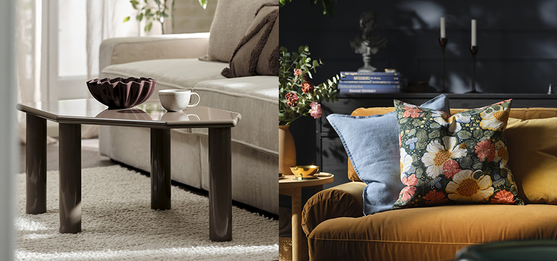

**Kimono** di **Fazzini** appartiene al mondo dei continuativi che viene aggiornato con i colori di stagione per dialogare con le nuove collezioni: svela le varianti blu e rosa sandalo, oltre a un modello di Yukata.

**Pop Light** di **Native Union** lanterna contemporanea, portatile e giocosa: combina un design retro-moderno con un controllo analogico intuitivo: ruota il quadrante per regolare la luminosità, premilo per cambiare la temperatura colore. Nessuna app, solo semplicità. Dati tecnici: Autonomia: fino a 120 h. Funzioni: power bank, dimmer integrato, 3 modalità di luce. Cavo POP incluso. Per interni ed esterni. 
Colori: Alarm Red, Azur, Sandstone, Pine, Lemon, Candy. Distribuito in Italia da Moroni Gomma

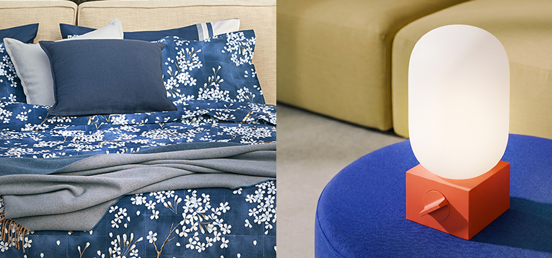

**Allegorie** di **Debonademeo Studio** che ha raccolto il patrimonio gestuale di Bottega Vazzoler e le sue tecniche tramandate — trasformandoli in un lessico materico che diventa contemporaneo senza perdere la sua radice. Un’eleganza arcaica, fatta di linee sinuose, superfici vibranti, segni netti. Le creazioni evocano forme ancestrali: vasi che richiamano l’arte etrusca, volumi costruiti per layer sovrapposti, ognuno portatore di una diversa lavorazione.

**Virna** di **Vermobil** Una ricerca che parte dal design e arriva alla materia per questa poltrona outdoor di una eleganza senza tempo, per godere delle ultime belle giornate all’aperto. La produzione 100% italiana e la competenza nella lavorazione di acciaio, inox e alluminio sono infatti indicate tra i punti fondanti dell'identità aziendale.

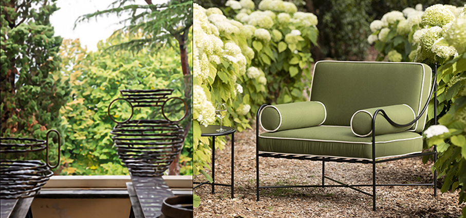

**Loft - Screziato** di **Alessandro Bini Tessuti d'Italia** appartiene alla Loft Collection ed è un vero capolavoro di tessitura: un effetto nuvolato di velluto dal pelo alto e setoso, realizzato con un telaio jacquard sulla base del suo coordinato unito. Disponibile in otto varianti di colore.

**Konstrunda** di **Ikea** vaso nero in vetro soffiato a bocca nero opaco cattura l'attenzione anche da solo, senza fiori o oggetti al suo interno. Una collezione per stimolare l'interesse per l'arte, suscitare emozioni e diffondere gioia.

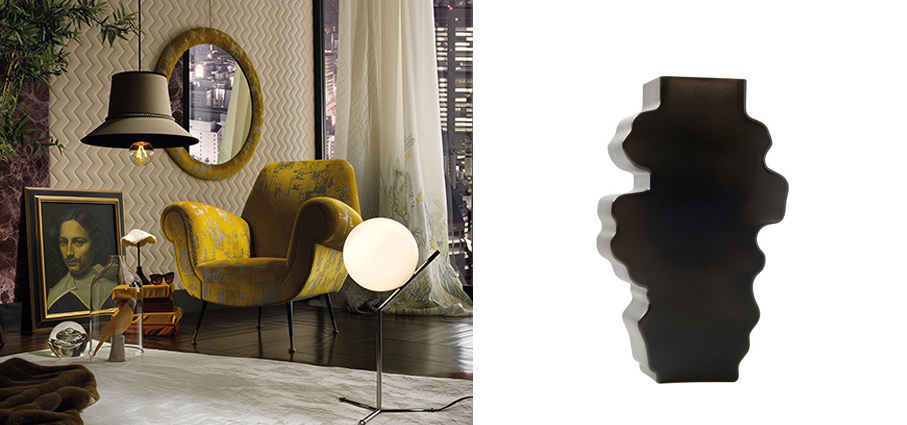

**Curve** di **Fiora** nuova collezione con un lato curvo che le conferisce un tocco elegante e moderno con linee sottili e ondulate. Completamente personalizzabili sui frontali e sui lati con finiture e colori che si adattano a ogni design e spazio. Con due modelli di frontali: Curve Simple è l’opzione con frontale dritto, senza maniglia e con sistema di apertura e chiusura a spinta.

**X-Series** di **Daikin** è la nuova soluzione residenziale che riunisce in un unico sistema riscaldamento idronico (anche tramite pavimento radiante), raffrescamento e produzione di acqua calda sanitaria. Pensata per abitazioni di nuova costruzione e ristrutturazioni fino a 150 m², integra le tecnologie aria-aria e aria-acqua in un unico sistema misto, offrendo flessibilità nella configurazione e nella scelta dei terminali. Il sistema, che può gestire fino a quattro unità interne aria-aria, utilizza refrigerante R-32, raggiunge classi energetiche fino ad A+++ in raffrescamento e dispone inoltre di serbatoi per ACS da 180 o 230 lt. La gestione da remoto tramite l’app Daikin Onecta consente di controllare da remoto il funzionamento del sistema e di monitorarne costantemente i consumi. comfort, programmazione e produzione di acqua calda sanitaria.

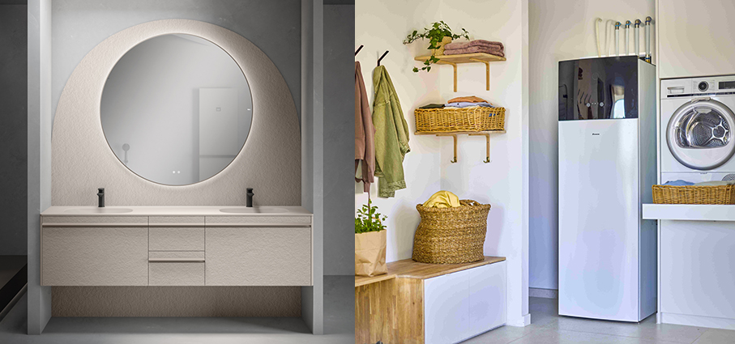

